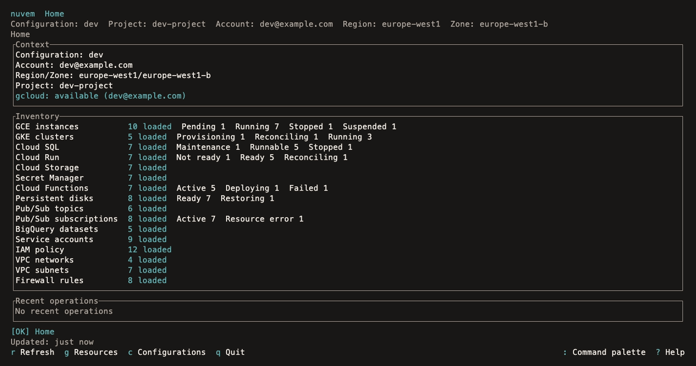

# nuvem

[](https://github.com/filipeaaoliveira/nuvem/actions/workflows/ci.yml)
[](LICENSE)

A terminal UI for Google Cloud, in the spirit of k9s. Browse and operate your
Google Cloud projects from the keyboard, with the gcloud configurations you
already have. The name is Portuguese for "cloud".

The documentation is at [nuvem.fyi](https://nuvem.fyi).



## Install

With [Homebrew](https://brew.sh), on macOS or Linux:

```bash
brew install filipeaaoliveira/tap/nuvem
```

Each [GitHub release](https://github.com/filipeaaoliveira/nuvem/releases) also
has a binary for Linux (x86_64 and arm64) and macOS (Apple silicon and Intel).
Every archive comes with a SHA-256 checksum and a signed build-provenance
attestation. [Download a release](https://nuvem.fyi/docs/getting-started/install/#download-a-release)
shows how to check and install one.

To build from source, you need Rust 1.94 or newer, a C toolchain and
`cmake`. `rustup` installs the pinned Rust version for you.

```bash
git clone https://github.com/filipeaaoliveira/nuvem
cd nuvem
cargo install --path . --locked
```

nuvem runs on Linux and macOS. On Windows, it runs only inside WSL.

## First run

To try nuvem without a Google Cloud account, start it in demo mode:

```bash
nuvem --demo
```

Demo mode runs the whole interface on built-in sample data. Lifecycle
actions and configuration changes report success and change nothing.

To use your own projects, you need the
[Google Cloud CLI](https://cloud.google.com/sdk/docs/install) (`gcloud`),
signed in. Homebrew does not install it for you.

```bash
gcloud auth login   # once, if you have not signed in yet
nuvem               # opens on your active gcloud configuration
```

Press `g` to open Resources, `Tab` to move to the service sidebar, and
`Enter` to open a service. Press `/` to filter a list and `:` to open the command
palette. Press `?` to see every key for the view you are in, and `Ctrl-C` to
quit.

## What it does

- Lists sixteen services: GCE instances, GKE clusters, Cloud SQL, Cloud Run,
  Cloud Storage, Secret Manager, Cloud Functions, persistent disks, Pub/Sub
  topics, Pub/Sub subscriptions, BigQuery datasets, service accounts, IAM
  policy, VPC networks, VPC subnets and firewall rules. Each one opens as a
  list you can sort and filter.
- Opens a detail pane for a row in GCE instances, GKE clusters, Cloud SQL,
  Cloud Run and Secret Manager. In Cloud Storage, a bucket opens its objects.
  In BigQuery datasets, a dataset opens its tables, and a table opens its
  schema.
- Runs lifecycle actions: start, stop, reset, suspend and resume on GCE
  instances, and start, stop, restart and fail over on Cloud SQL. You choose
  them in the command palette. To run one on several instances at once, mark
  them with `Space` first.
- Opens an SSH session to a GCE instance, and opens a GKE cluster in k9s.
- Starts IAP, SSH and Cloud SQL Auth Proxy tunnels with `t`, and lists them in
  one place (`Ctrl-t`).
- Reads, tails and searches Cloud Logging. `l` opens the project's logs, and
  `L` opens the logs of the selected resource in most services.
- Switches between your gcloud configurations, and edits the project, region
  and zone of the active one (`c`).
- Runs plugins, which are `gcloud` commands you define, against the selected
  row.

Before nuvem changes a cloud resource, it shows what it is about to do and
waits for you to confirm. For a lifecycle action, the confirmation names the
action, the resource, the project, the impact and the API call. For a plugin,
it shows the `gcloud` command line. Start nuvem with `--read-only` to refuse
every change to a cloud resource.

## How nuvem reaches Google Cloud

nuvem reads most data through the official Google Cloud client libraries for
Rust. It authenticates with a short-lived access token from
`gcloud config config-helper` for your active gcloud configuration. The token
stays in memory, and nuvem never writes it to disk. nuvem stores no
credentials of its own. It reads BigQuery through `bq`, which ships with the
Google Cloud CLI. Lifecycle actions go through the same client libraries.
SSH sessions, tunnels to GCE instances, plugins and changes to your gcloud
configurations run `gcloud`, and Cloud SQL tunnels run `cloud-sql-proxy`.

## Documentation

Start with
[Install](https://nuvem.fyi/docs/getting-started/install/),
[First run](https://nuvem.fyi/docs/getting-started/first-run/),
[Keys](https://nuvem.fyi/docs/reference/keys/) and
[All services](https://nuvem.fyi/docs/reference/services/overview/). The
documentation also covers the Home overview, FinOps, related-resource jumps,
themes and the config file.

The same pages are in [`docs/`](docs) as Markdown:

<details>
<summary>Every user page in <code>docs/</code></summary>

- Getting started:
  [Install](docs/getting-started/install.md),
  [First run](docs/getting-started/first-run.md),
  [Reading the screen](docs/getting-started/the-screen.md)
- Guides:
  [Home overview](docs/guides/home-overview.md),
  [Browse resources](docs/guides/browse-resources.md),
  [Filter a list](docs/guides/filter-a-list.md),
  [Switch gcloud configurations](docs/guides/switch-configurations.md),
  [Command palette](docs/guides/command-palette.md),
  [Batch actions on marked rows](docs/guides/batch-actions.md),
  [Cloud Logging](docs/guides/cloud-logging.md),
  [Tunnels](docs/guides/tunnels.md),
  [Related-resource jumps](docs/guides/related-resource-jumps.md),
  [FinOps](docs/guides/finops.md),
  [Demo mode](docs/guides/demo-mode.md),
  [Read-only mode](docs/guides/read-only-mode.md)
- Configuration:
  [Config file](docs/configuration/config-file.md),
  [Themes and frame colors](docs/configuration/themes.md),
  [Hotkeys](docs/configuration/hotkeys.md),
  [Service aliases](docs/configuration/aliases.md),
  [Favorites](docs/configuration/favorites.md),
  [Columns and sort](docs/configuration/columns-and-sort.md),
  [Jump rules](docs/configuration/jump-rules.md),
  [Remembered last view](docs/configuration/remembered-view.md),
  [Reload configuration](docs/configuration/reload.md),
  [Config problems](docs/configuration/config-problems.md)
- Plugins:
  [How plugins work](docs/plugins/overview.md),
  [Write a plugin](docs/plugins/write-a-plugin.md),
  [Typed inputs](docs/plugins/typed-inputs.md),
  [Plugin output](docs/plugins/plugin-output.md),
  [Plugin file reference](docs/plugins/plugin-file-reference.md)
- Reference:
  [Keys](docs/reference/keys.md),
  [Command line](docs/reference/cli.md),
  [Palette commands](docs/reference/commands.md)
- Services:
  [All services](docs/reference/services/overview.md),
  [GCE instances](docs/reference/services/gce-instances.md),
  [GKE clusters](docs/reference/services/gke-clusters.md),
  [Cloud SQL](docs/reference/services/cloud-sql.md),
  [Cloud Run](docs/reference/services/cloud-run.md),
  [Cloud Storage](docs/reference/services/cloud-storage.md),
  [Secret Manager](docs/reference/services/secret-manager.md),
  [Cloud Functions](docs/reference/services/cloud-functions.md),
  [Persistent disks](docs/reference/services/persistent-disks.md),
  [Pub/Sub topics](docs/reference/services/pubsub-topics.md),
  [Pub/Sub subscriptions](docs/reference/services/pubsub-subscriptions.md),
  [BigQuery datasets](docs/reference/services/bigquery-datasets.md),
  [Service accounts](docs/reference/services/service-accounts.md),
  [IAM policy](docs/reference/services/iam-policy.md),
  [VPC networks](docs/reference/services/vpc-networks.md),
  [VPC subnets](docs/reference/services/vpc-subnets.md),
  [Firewall rules](docs/reference/services/firewall-rules.md)
- Troubleshooting:
  [Common problems](docs/troubleshooting/common-problems.md),
  [Questions](docs/troubleshooting/faq.md)

</details>

## Contributing

[CONTRIBUTING.md](CONTRIBUTING.md) explains the development setup and the
checks a change must pass. [ARCHITECTURE.md](ARCHITECTURE.md) explains how
the code fits together. To report a security problem, follow
[SECURITY.md](SECURITY.md) and do not open a public issue. Changes between
releases are in [CHANGELOG.md](CHANGELOG.md).

## License

nuvem is licensed under the [MIT License](LICENSE).

nuvem is an independent project. It is not affiliated with, endorsed by or
sponsored by Google. Google Cloud and gcloud are trademarks of Google LLC.
